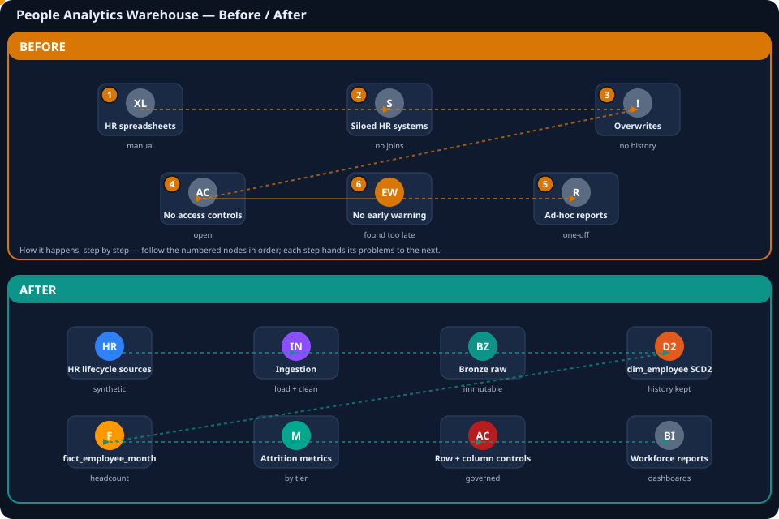

# People Analytics Warehouse

Portfolio implementation based on production work experience. All data is synthetic, all code is original and clean-room, and no proprietary code, data, schema names, or internal system details from any employer are included.

**Original context:** Pipelines for People (HR) teams: employee lifecycle and HR operational data into governed, dimensionally modelled curated layers (SCD Type 1 and 2) powering attrition, headcount and workforce reporting, with row and column level access controls. Plus earlier consulting work on a multi-class model to explain and predict employee churn by performance tier and attrition risk.

**This portfolio version:** Synthetic HR records only, SQL dimensional models that run on SQLite, SCD2 logic in Python, and attrition metrics.

## Run
```bash
python -m src.load_synthetic
python -m src.scd2_demo
python -m pytest tests/ -q
```
## Models
- `dim_employee` (SCD2: history preserved on department / manager change)
- `fact_employee_month` (headcount, joins, exits, attrition rate)
- Access model documented in `docs/access_controls.md`: row level by org, column masking for sensitive fields

## Architecture — Before / After

Hover any component to see what it is and why it is needed.


<details>
<summary><b>SCD2 + access controls — click to expand the 4 steps</b></summary>

Collapsed, this is just: HR lifecycle sources -> Ingestion -> Bronze raw -> dim_employee SCD2

1. Employee lifecycle and HR operational data is the governed source.
2. Data is loaded and cleaned into the warehouse, so downstream models start clean.
3. The raw bronze layer is kept immutable, so any curated table can be rebuilt from source.
4. dim_employee uses SCD Type 2, so department and manager changes keep history.

Governed by the Row + column controls step that follows in the flow: row-level access by org and column masking for sensitive fields.
</details>

### Earlier issues, risk, and impact after

| Aspect | Detail |
|---|---|
| Earlier issues | Headcount and attrition tracked in spreadsheets, so numbers differed by who counted; HR data siloed across systems, so lifecycle questions needed manual joins; changes overwrote the old value, so history was lost and trends could not be trusted; sensitive HR fields open to everyone; reports built one-off by hand, so the same question got different answers; no early warning on attrition risk. |
| Risk | Once history was overwritten, trends could not be trusted and past headcount could not be reconstructed; sensitive fields were exposed to anyone who could query the data; high-risk segments were only found after people left. |
| Impact after | Lifecycle data lands in governed, dimensionally modelled layers with history preserved (SCD2); attrition and churn metrics by performance tier and risk flag high-risk segments early; row-level access by org and column masking enforce privacy; leaders see one version of the truth in workforce reports. |

